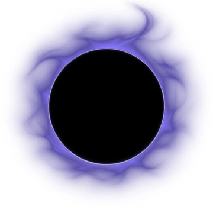
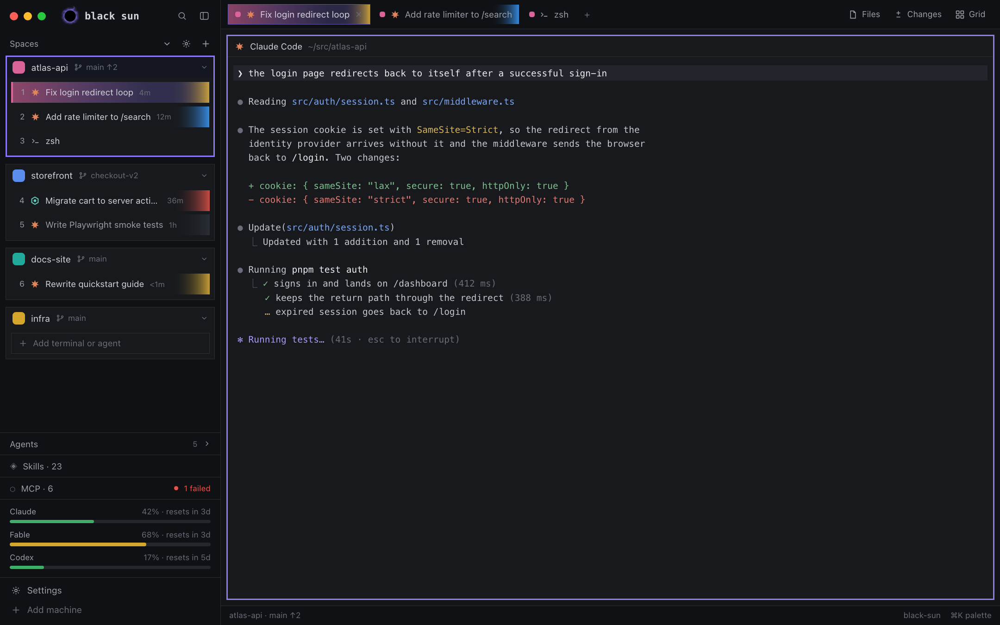
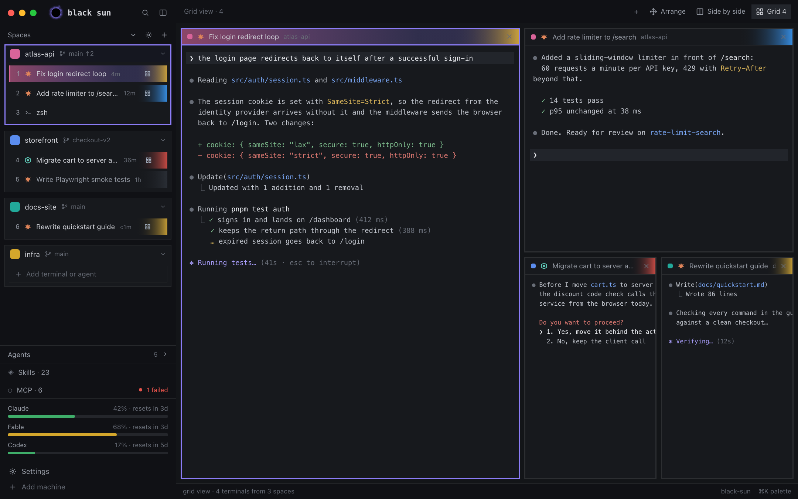
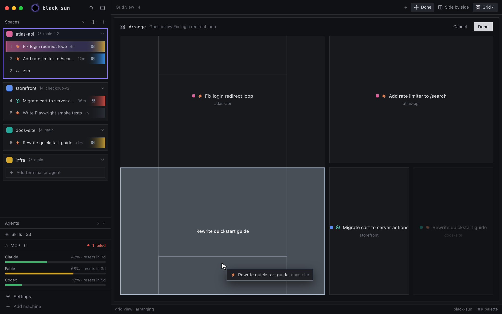
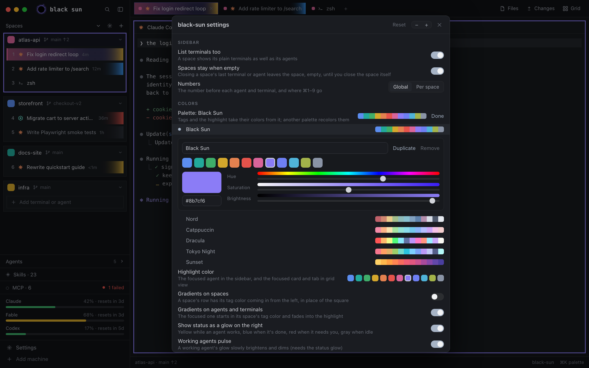
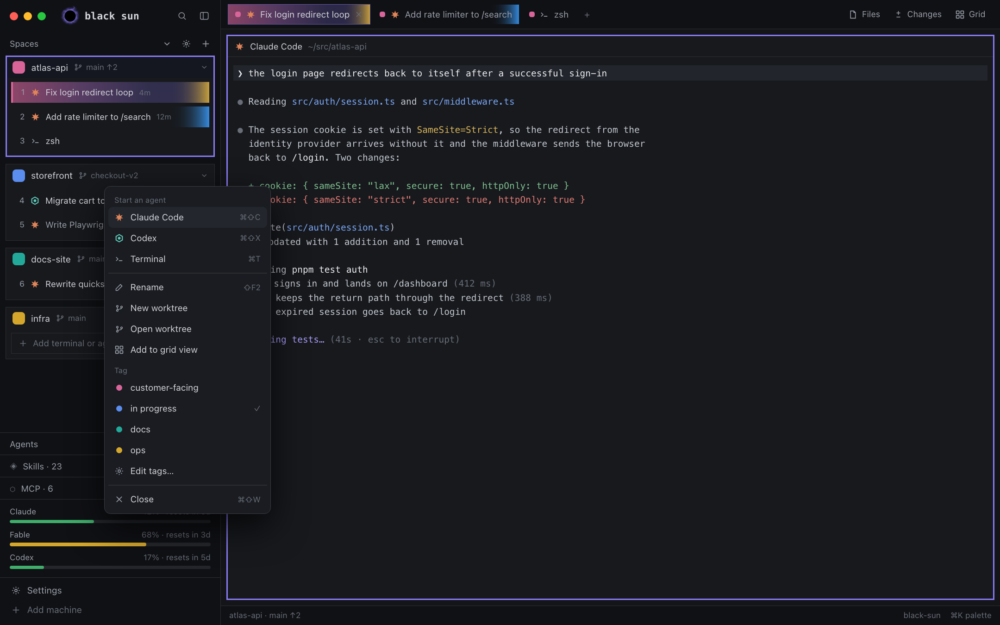

<h1 align="center">
   black sun
</h1>

<p align="center">
  A <a href="https://herdr.dev">Herdr</a> layout for running many coding agents at once<br>
  and always knowing which one needs you.
</p>

## What it does

black-sun turns Herdr into a control room for Claude Code and Codex agents. Every space (a project, a branch, a worktree) is a box in the sidebar with its agents and terminals inside, each named after what it is doing. A glow on the right of each row tells you at a glance who is working, who is done and who is waiting for you, and ⌘1–9 jump to any of them from anywhere.

A grid view puts terminals from different spaces next to each other, in any arrangement of rows and columns, so you can watch several agents at once. Two buttons in the sidebar show exactly which skills and MCP servers each agent has loaded and where they come from. Bars at the bottom show how much of your weekly Claude and Codex limits is used.

This is how I like to run my agents, so it is built around my own workflow. It has some features I think are cool, and I will keep changing it as it suits me.

It is a layout plus eleven small mods. Installing it leaves your own layouts and mods as they are, and `Ctrl+Shift+L` switches back.

## What it looks like



*Spaces as boxes with their agents and terminals. The focused agent fades from its space's color into the highlight; yellow is working, blue is done, red needs you.*

| | |
|---|---|
|  |  |
| *Grid view: terminals from three spaces, one of them a full-height column.* | *Arrange: drag a tile; the see-through tile shows where it lands.* |
|  |  |
| *Settings: palettes, the highlight color, gradients and the status glow.* | *A space's menu: start an agent there, worktrees, grid view, tags.* |

## Install

Ask any coding agent:

```
Read ~/.config/herdr-app/AGENTS.md, then add this layout: herdr.dev/layouts/jorgeper/black-sun
```

It reads every file first, adds the layout and its mods next to yours (yours stay as they are), and switches to it. `Ctrl+Shift+L` switches back. It needs macOS and Claude Code.

For the hotkeys, open black-sun's settings (the gear in the Spaces header) and click **Add missing keys**, or add them yourself ([see below](#hotkeys-in-keysjson)).

## What black-sun gives you

### Spaces, agents and terminals

- **Each space is a box** in the sidebar with its agents and plain terminals inside. Chevrons fold one space, or all of them down to just the spaces.
- **Each row** shows its number, its icon and name, and right after the name how long it has been in its current state.
- **Numbers you can jump to.** Rows count 1, 2, 3… down the whole sidebar, so ⌘3 is the same agent wherever you are. A setting counts them per space instead.
- **Spaces that stay.** Closing a space's last terminal or agent leaves the space, empty, with an **Add terminal or agent** button, until you close the space itself.
- **Drag a space to reorder.** The space goes faint, a small card follows the pointer, and a slot with its name shows where it will land: above or below the space you're over.
- **Worktrees** sit under their checkout, and spaces on other machines are grouped under the machine.
- **A foldable Agents list.** Herdr's Agents list, sorted by priority or grouped by space; its chevron folds it down to its header to give Spaces the room.

### Status and focus at a glance

- **Status is a glow** coming in from the right edge of a row, in place of spinners and dots: yellow while an agent works (slowly pulsing), blue when it's done, red when it needs you, a faint gray when idle.
- **The focused one stands out.** The agent or terminal with the keyboard is tinted in a highlight color you choose, starting in its space's color and fading into the highlight. Its pane and its space's box have their border in that color.
- **The same everywhere.** Sidebar rows, the tab bar's tabs and grid view's card titles are all drawn the same way.

### Grid view

- **Terminals from any spaces next to each other**, in place of the shown space's tabs: the **Grid** button at the right end of the tab bar. Agents and plain terminals alike, each a card with a title bar.
- **Add** a terminal from an agent's or a space's right-click menu, by dragging an agent from the sidebar, or with **+** above the grid. **✕** on a card takes it out; it keeps running.
- **Arrange** shows the grid as small tiles to drag into rows and columns, nested as deep as you like: one terminal can take a full-height column while others stack beside it. A see-through tile shows where the terminal would land and how big it would be. A tile's edge puts it beside that tile; closer to the edge, beside the bigger group that ends there; its middle swaps the two. Drag the gaps to resize.
- **Side by side** puts everything back in one row, each the same width.

### Agent names

- An agent's sidebar row and its tab show the same name: up to 5 words on the row, 2–3 on the tab. They come from the agent's own title; one too long for the tab is shortened by Claude Haiku.
- A just-started agent reads `<new>` until it says what it's doing.
- **Rename** (F2) lets you type a name. **Auto-name** (⌘⇧R) names an agent after what its session is doing now. **Auto-name all** (⌘⇧A) does every agent at once. Automatic names never replace one you typed.

### Skills

- **Skills · N** in the sidebar opens a dialog with the skills a Claude agent has loaded, grouped by where they come from: this project, yours, your claude.ai account, each plugin, and built in. The project's `.agents/skills` (which Codex reads) is a group of its own.
- A dropdown switches agents. A Codex or other agent shows the `.agents/skills` folders it can read; **Global** shows everything installed, without duplicates.
- A skill's or plugin's **ⓘ** shows its kind, source, location on disk, description, and how to update or remove it.

### MCP servers

- **MCP · N** does the same for MCP servers: which connected and which failed (a red dot, all the way up the tree), the tools each one gave the agent, and its instructions.
- A server's **ⓘ** shows its status or error and how to fix it, and its config with every secret value hidden.

### Usage

- **Weekly usage** bars for Claude, Fable and Codex: how much of the weekly limit is used, and when it resets.

### Menus and hotkeys

- **Right-click an agent:** Rename, Auto-name, Auto-name all, Open in Finder, Add to (or Remove from) grid view, and Close (the whole tab when the agent is alone in it, otherwise just its pane).
- **Right-click a space:** start Claude Code, Codex, any other installed agent, or a terminal in *that* space; then Rename, worktrees, add all of its terminals to grid view, its tag, and Close.

| Hotkey | Does |
|---|---|
| ⌘1–9 | Go to the agent or terminal with that number, in any space (or, with numbers per space, in the space you're in) |
| ⌘⇧C / ⌘⇧X | New Claude Code / Codex agent in the space you're in |
| F2 | Rename the agent's tab |
| ⌘⇧R | Auto-name the focused agent |
| ⌘⇧A | Auto-name every agent |
| ⌘⇧F | Open the focused agent's folder in Finder |

The ⌘⇧ keys, and ⌘1–9 across spaces, need lines in your `keys.json`: Settings adds them for you. Without them ⌘1–9 stay Herdr's own: the tabs of the space you're in.

### Colors and tags

- **Palettes.** Pick a palette of 12 colors from 15 built-in ones (Black Sun, Nord, Catppuccin, Dracula, Gruvbox, Solarized, Tokyo Night, Rosé Pine and more), or duplicate one and make it yours: rename it, and change any color with a picker (hue, saturation, brightness, or a hex code).
- **One palette colors everything.** Tag colors and the highlight color come from the selected palette, so picking another palette recolors them all.
- **Space tags.** Make your own tags, each a name and a color (say "ephemeral" and "permanent"), and give each space one from its right-click menu. A space shows its tag as a colored square, as the whole row in that color, or (with gradients on spaces, off by default) as its color coming in from the left of its row. New spaces can start with a tag you choose.
- **Four switches:** gradients on agents and terminals, the status glow and the pulse for working agents are on; gradients on spaces are off until you turn them on.

### Settings

The gear in the Spaces header opens a window you can drag, with − and + to make it smaller or bigger; it opens again where and as big as you left it.

- **Sidebar:** show or hide the Agents list, Skills, MCP and Weekly usage; list plain terminals or only agents; offer **Add terminal or agent** in spaces with no agents; keep spaces when their last terminal is closed; number rows down the whole sidebar or per space.
- **Colors** and **Space tags:** as above.
- **Yolo mode:** start every new Claude Code and Codex agent without permission prompts (Codex also without its sandbox).
- **Agent names:** name agents after their titles or not, how many words go on a sidebar row (3–8) and on a tab (2–4), and whether Haiku shortens long tab names or words are simply cut.
- **Usage:** how often Claude and Fable usage refreshes (1, 5, 15 or 30 minutes).
- **Hotkeys:** which black-sun hotkeys are set, with a button that adds the missing ones to `keys.json`.
- A link to Herdr's own Settings → Look for the theme and fonts.

The rest is Herdr's own: panes as cards (with square corners here), Files and Changes panels, status bar.

## Mods

| Mod | What it does |
|---|---|
| `skill-tree` | A "Skills · N" row above the usage bars. Click it for a dialog: pick any running agent from a dropdown (or Global). A Claude agent shows its skills grouped into This project, This project · .agents/skills, Yours, claude.ai account, each Plugin, and Built into Claude Code; a Codex or other agent shows its project's and your personal `.agents/skills`. A skill's **ⓘ** shows what kind it is, where it came from (plugin and marketplace, `npx skills`, git repo), where it is on disk, its own description, and how to update or remove it. Each plugin has an **ⓘ** too. |
| `mcp-tree` | An "MCP · N" row under Skills (with a red dot and "N failed" when a server failed). Click it for the same kind of dialog: pick a Claude agent (or Global) and see its MCP servers grouped into This project (`.mcp.json`), This project just you, Yours, claude.ai connectors, and each Plugin, each with a status dot and its tool count. A server's **ⓘ** shows its status or error and how to fix it, the tools it gave the agent, the instructions it gives Claude, its config without any secret values, and how to update or remove it. |
| `black-sun-brand` | The bar at the top of the sidebar: the layout's name and its black sun icon, with Herdr's search and sidebar buttons. |
| `black-sun-tabs` | The tab bar: Herdr's, with each tab drawn as in grid view (tag, gradient, status glow). |
| `black-sun-empty` | What a space with no terminal shows: a line saying so and **Add terminal or agent**. It is also the hidden placeholder tab that keeps such a space open. |
| `side-by-side` | Grid view: the Grid, Arrange and Side by side buttons at the end of the tab bar, the bar above the grid, each card's title bar, the arrange view and the **+** picker. |
| `spaces-tree` | Herdr's spaces list with each space in a box, its agents and plain terminals inside. The focused one is tinted in the highlight color, and an agent's status glows in from the right. Each agent row shows the ⌘-number of its tab, how long it has been in its status (as the Agents list does), and its status. Each agent gets two names from the same title: up to 5 words on its sidebar row, 2–3 on its tab (the Agents list shows the tab's). A just-started agent shows `<new>` in both until it says what it's doing. Right-click an agent for **Rename** (F2), **Auto-name** (⌘⇧R), which names both after what its session is doing now, or **Auto-name all** (⌘⇧A) for every agent at once. A name you type shows in both. **Open in Finder** (⌘⇧F) shows the folder the agent is in. |
| `agents-list` | Herdr's Agents list with a chevron in its header that folds it down to the header, giving Spaces the room, and opens it again. |
| `sidebar-menu` | The sidebar's right-click menus, drawn like Herdr's own. An agent's: Rename, Auto-name, Auto-name all, Open in Finder, Close. A space's: **start Claude Code (⌘⇧C), Codex (⌘⇧X)** or any other installed agent, or a terminal, in that space; then Rename, worktrees, grid view, tags and Close. An agent's menu also adds it to, or takes it out of, grid view. ⌘⇧C and ⌘⇧X work from anywhere and start the agent in the space you're in. |
| `black-sun-settings` | The settings window behind the Spaces header's gear. Color palettes and space tags are made here. |
| `weekly-usage` | Three bars: weekly limits used for Claude, Fable and Codex, with time to reset. |

## What it reads and runs

- `weekly-usage` reads your Claude Code login from the macOS keychain to call Anthropic's usage endpoint (the token never leaves the shell command), and reads your newest Codex session log.
- `skill-tree` reads Claude Code's session files and skill folders under `~/.claude`, shared skills under `~/.agents/skills` and each agent's `<folder>/.agents/skills`, and runs `ps` to match each session to its Herdr terminal. It never writes anything and never runs the update or remove commands it shows; Reveal just runs `open -R`.
- `spaces-tree`'s **Auto-name** reads the end of that agent's session log (Claude Code's under `~/.claude/projects`, or the newest Codex log for that folder under `~/.codex/sessions`), takes up to 4,000 characters of what was said (no tool output), and asks Claude Haiku for a title with `claude -p`, using your own Claude Code login, for Codex agents too. It runs only when you ask, and changes nothing but the tab's name. To keep tab names short, a title longer than a tab allows (3 words by default) is also shortened by Haiku when it first appears; only the title is sent (no conversation). Settings can turn that off, or turn off naming after titles altogether.
- `spaces-tree`'s **Open in Finder** runs `open <folder>` on the agent's current folder, only when you ask.
- `side-by-side` reads nothing outside Herdr. When the grid has a split inside a split, it runs `herdr-app do layout.set` (Herdr's own command line) to show it, because Herdr takes only so much nesting in a layout handed over by a mod directly.
- `agents-list`, `sidebar-menu`, `black-sun-brand`, `black-sun-tabs` and `black-sun-empty` read nothing outside Herdr. `black-sun-settings` keeps its settings, the color palettes and the space tags in Herdr's shared state, and writes `keys.json` only when you click **Add missing keys** (it adds black-sun's section and changes nothing else). Its yolo switch writes Herdr's `programs.json` when you flip it: it adds `--dangerously-skip-permissions` to how Claude Code starts and `--dangerously-bypass-approvals-and-sandbox` to Codex's (and takes them out again), so it applies to every menu and layout in Herdr, and leaves the rest of the file as it is.
- `mcp-tree` reads the same session files plus MCP configs: `~/.claude.json` (through a small Python filter that passes on only server names, URLs without credentials or query, program names, and header and environment variable *names*, never their values), the project's `.mcp.json`, and enabled plugins' `.mcp.json`. It never shows a secret, never writes anything and never runs the commands it shows.

## Hotkeys in keys.json

For the hotkeys (⌘⇧R, ⌘⇧A, ⌘⇧C, ⌘⇧X, ⌘⇧F, and ⌘1–9), add this to `~/.config/herdr-app/keys.json` (installing the layout doesn't touch your keys):

```json
"layout:black-sun": {
  "cmd-shift-r": "spaces-tree.auto-name",
  "cmd-shift-a": "spaces-tree.auto-name-all",
  "cmd-shift-c": "spaces-tree.new-claude",
  "cmd-shift-x": "spaces-tree.new-codex",
  "cmd-shift-f": "spaces-tree.open-finder",
  "cmd-1": "spaces-tree.go-1",
  "cmd-2": "spaces-tree.go-2",
  "cmd-3": "spaces-tree.go-3",
  "cmd-4": "spaces-tree.go-4",
  "cmd-5": "spaces-tree.go-5",
  "cmd-6": "spaces-tree.go-6",
  "cmd-7": "spaces-tree.go-7",
  "cmd-8": "spaces-tree.go-8",
  "cmd-9": "spaces-tree.go-9"
}
```

Details for agents (and for rebuilding it) are in [RECIPE.md](RECIPE.md).

## Updating

Replace `layouts/black-sun.json` and the eleven folders under `mods/` with the latest from this repo.

## License

MIT ([LICENSE](LICENSE)). `spaces-tree`, `agents-list`, `black-sun-brand`, `black-sun-tabs` and the layout are modified copies of Herdr's `spaces`, `agents`, `workspace-chrome` and `tabs` mods and `main` layout, used under the Apache License 2.0 ([LICENSE-herdr](LICENSE-herdr)).
